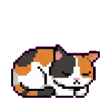
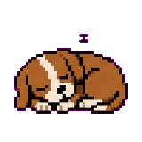
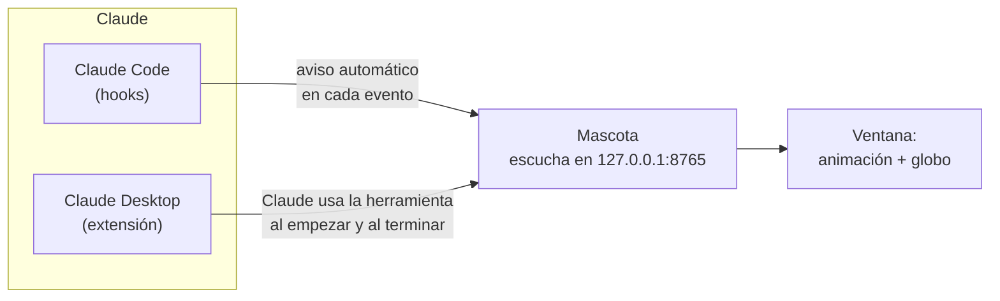

# Mascota

<p align="center">
  
  
  
</p>

<p align="center">
  Una mascota de escritorio que reacciona a lo que hace <b>Claude</b>.<br>
  Duerme mientras esperás, piensa mientras Claude prepara la respuesta,<br>
  te avisa cuando necesita tu permiso y festeja cuando termina.
</p>

Funciona en **Windows, macOS y Linux**, con **Claude Code** (en la terminal, en
VS Code o en la pestaña Code de la app) y con el **chat de Claude Desktop**.
Trae tres mascotas en pixel art: gato, perro y robot.

---

## Antes de instalar

Revisá estos requisitos, porque son la causa de casi todos los problemas:

| Requisito | Detalle |
|---|---|
| **Python 3.9 o superior** | Recomendamos el de [python.org](https://www.python.org/downloads/). En Windows, marcá **"Add Python to PATH"** durante la instalación. |
| **Claude Code o Claude Desktop** | Cualquiera de los dos; podés usar la mascota con ambos a la vez. |
| **Conexión a internet la primera vez** | Al primer arranque, la mascota instala lo que necesita (PySide6, unos 200 MB) en un entorno propio. Tarda un par de minutos; después abre al instante. |
Para verificar que tenés Python, abrí una terminal y escribí `python --version`
(en macOS y Linux, `python3 --version`). Tiene que responder `Python 3.9` o un
número mayor.

---

## Instalación

### En Claude Code

1. Abrí Claude Code y escribí:

   ```
   /plugin marketplace add pepe-avila/mascota
   /plugin install mascota@pepe-avila
   ```

2. Cuando te pregunte cómo se llama Python en tu sistema, respondé **`python`**
   en Windows o **`python3`** en macOS y Linux.

3. Empezá una sesión nueva. La mascota aparece sola en la esquina inferior
   derecha de la pantalla.

### En Claude Desktop (chat)

1. Descargá **`mascota.mcpb`** desde la página de
   [Releases](https://github.com/pepe-avila/mascota/releases/latest).
2. Abrilo con doble clic, o en Claude Desktop andá a
   **Configuración → Extensiones → Instalar extensión** y elegilo.
3. Cerrá Claude Desktop del todo (también desde el ícono junto al reloj) y
   volvé a abrirlo. La mascota aparece sola.
4. La primera vez que chatees, Claude te va a pedir permiso para usar la
   herramienta de la mascota: elegí **Permitir siempre**.

Si tenés varias versiones de Python, podés indicar cuál usar en
**Configuración → Extensiones → Mascota**. Si lo dejás vacío, la busca sola.

---

## Cómo se usa

La mascota trabaja sola: no tenés que hacer nada mientras usás Claude.

### Qué significa cada estado

| Estado | Cuándo pasa | Qué dice |
|---|---|---|
| **Esperando** | no está pasando nada | — |
| **Pensando** | Claude está preparando la respuesta | "Preparando respuesta…" |
| **Permiso** | Claude necesita que apruebes algo | "¡Necesito tu permiso!" |
| **Listo** | Claude terminó; festeja unos segundos y vuelve a dormir | "¡Ya está!" |
| **Cansado** | llegaste al límite de uso | "Llegamos al límite de uso" |

En el chat de Claude Desktop solo se ven *pensando* y *listo*: el chat no
avisa cuando hace falta un permiso ni cuando se llega al límite.

### Con el mouse

- **Clic izquierdo y arrastrar:** la movés adonde quieras.
- **Clic derecho:** abre el menú, donde podés:
  - cambiar de mascota (gato, perro o robot; la elección se recuerda);
  - forzar un estado, para ver las animaciones;
  - salir.
- El mismo menú está en el **ícono de la bandeja del sistema** (junto al reloj
  en Windows, en la barra de menú en macOS).

### Si la cerraste

- En Claude Code, escribí `/mascota:abrir`.
- En Claude Desktop, se vuelve a abrir sola en la próxima respuesta de Claude.

### Ajustes

La primera vez que se abre, la mascota crea un archivo `config.json` que podés
editar con cualquier editor de texto. Está en `~/.claude-mascota/` si la abrió
Claude Desktop, o en la carpeta de datos del plugin si la abrió Claude Code.
Los ajustes más útiles:

| Ajuste | Qué hace |
|---|---|
| `"abrir_al_iniciar": false` | deja de abrirse sola; la abrís con `/mascota:abrir` |
| `"tamanio": 128` | tamaño de la mascota, en píxeles |
| `"puerto": 8765` | cambialo solo si otro programa ya usa ese puerto |

Los cambios se aplican la próxima vez que se abre la mascota.

### Si algo no anda

| Problema | Qué hacer |
|---|---|
| No aparece la mascota | Revisá los [requisitos](#antes-de-instalar), sobre todo la versión de Python. |
| "No encuentro Python" | Instalá Python desde python.org y abrí una terminal o Claude nuevos. |
| En Claude Desktop la extensión figura como fallida | Mirá `~/.claude-mascota/extension.log`: ahí dice qué Python eligió y qué falló. |
| "El puerto está ocupado" | Otro programa usa el puerto 8765. Cambiá `puerto` en el `config.json`. |
---

## Cómo funciona

La mascota es un programa aparte que escucha avisos en tu propia máquina.
Claude Code y Claude Desktop le avisan, cada uno a su manera, qué está pasando:



- **En Claude Code**, el plugin trae *hooks*: avisos que Claude Code manda solo
  cada vez que pasa algo (mandaste un mensaje, Claude terminó, hace falta un
  permiso). Son instantáneos y exactos.
- **En Claude Desktop**, el chat no tiene esos avisos. La extensión le da a
  Claude una herramienta, `mascota_estado`, y le pide que la use al empezar y al
  terminar cada respuesta.
- **En los dos casos**, al arrancar se abre la mascota si no estaba abierta, y
  nunca se abren dos a la vez.

Todo pasa en tu computadora: la mascota solo acepta avisos de tu propia máquina,
no manda nada a internet y no tiene telemetría.

---

## Apartado técnico

### Qué hay en el repositorio

```
.claude-plugin/marketplace.json   catálogo del plugin
plugins/mascota/                  plugin de Claude Code
├── hooks/hooks.json              avisos automáticos a la mascota
├── skills/abrir/SKILL.md         comando /mascota:abrir
├── scripts/                      la mascota (Python + PySide6)
│   ├── mascota.py                ventana, animación, menú
│   ├── servidor.py               servidor HTTP local que recibe los avisos
│   ├── arrancar.py               prepara el entorno y abre la ventana
│   ├── config.py                 valores compartidos
│   ├── arte.py · uso.py          dibujos y uso restante
│   └── control.py · statusline.py   herramientas para Claude Code
└── sprites/                      los dibujos de cada mascota
extension/                        extensión de Claude Desktop (Node)
├── manifest.json
├── server/                       servidor MCP
├── tests/                        pruebas automáticas
└── empaquetar.py                 arma dist/mascota.mcpb
docs/img/                         imágenes de este README
```

La extensión no duplica código: `empaquetar.py` toma los scripts del plugin.

### Desarrollo

```bash
git clone https://github.com/pepe-avila/mascota
claude plugin marketplace add ./mascota      # usar tu copia local como marketplace
claude plugin install mascota@pepe-avila      # e instalar el plugin desde ahí
node --test                                   # pruebas de la extensión
python extension/empaquetar.py                # armar dist/mascota.mcpb
```

Para probar la ventana sola: `python plugins/mascota/scripts/mascota.py` (con
PySide6 instalado) y, en otra terminal,
`curl -X POST http://127.0.0.1:8765/estado/pensando`. Las teclas **1** a **5**
fuerzan cada estado.

Si cambiás la versión, tiene que ser la misma en
`plugins/mascota/.claude-plugin/plugin.json` y en `extension/manifest.json`.

### Agregar tu propia mascota

Creá una carpeta en `plugins/mascota/sprites/` con PNG de fondo transparente
llamados `esperando_0.png`, `pensando_0.png`, `permiso_0.png`, `listo_0.png`
(y los cuadros siguientes: `_1`, `_2`…). Aparece sola en el menú. Más detalles
en [`sprites/LEEME.md`](plugins/mascota/sprites/LEEME.md).

---

## Licencia

[MIT](LICENSE) © Pedro Avila Domizi
